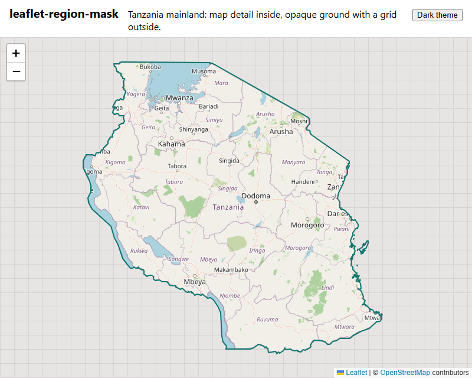
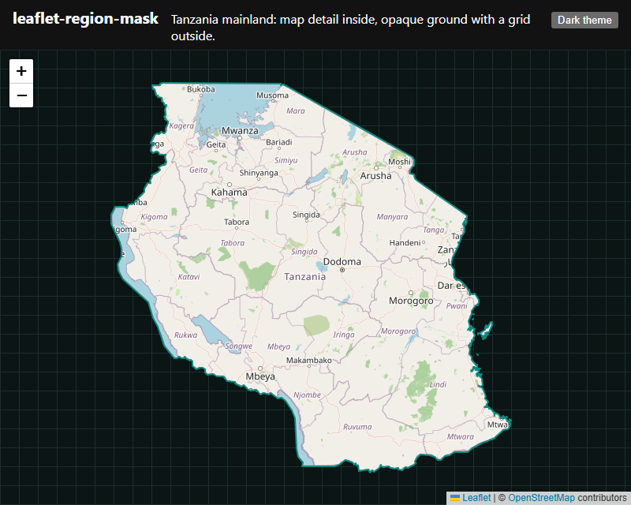

# leaflet-region-mask

[](https://www.npmjs.com/package/leaflet-region-mask)
[](https://bundlephobia.com/package/leaflet-region-mask)
[](LICENSE)
[](https://github.com/immanewel/leaflet-region-mask/actions/workflows/ci.yml)

Leaflet plugin: show map detail only inside a region. Outside is an opaque ground with a grid, themed by CSS
variables, with no flash of world tiles. Leaflet 1.9 is the only peer dependency. About 1.5 KB min+gzip (JS + CSS).

| Light                                                        | Dark                                                       |
| ------------------------------------------------------------ | ---------------------------------------------------------- |
|  |  |

## Install

```sh
npm install leaflet leaflet-region-mask
```

## Usage

ESM, with the CSS imported once (a bundler such as Vite or webpack handles the `.css` import):

```ts
import 'leaflet/dist/leaflet.css'
import 'leaflet-region-mask/region-mask.css'
import { map, tileLayer } from 'leaflet'
import { regionMask } from 'leaflet-region-mask'

const m = map('map').setView([-6.2, 35.7], 6)
tileLayer('https://tile.openstreetmap.org/{z}/{x}/{y}.png').addTo(m)

regionMask('/region.geojson') // or a GeoJSON object
  .on('ready', () => console.log('mask in place'))
  .on('error', (e) => console.warn('no mask, tiles show everywhere', e.error))
  .addTo(m)
```

The source is a GeoJSON object or a URL to one: a Polygon, MultiPolygon, Feature or FeatureCollection. Every
polygon (islands too) shows the map. Polygon holes (lakes) are masked again. A ring across the antimeridian stays in
one piece. Other geometry types are ignored.

`mask.remove()` removes the mask, its SVG renderer and its classes; the map returns to normal.

## Options

| Option                | Default                 | Meaning                                                                                      |
| --------------------- | ----------------------- | -------------------------------------------------------------------------------------------- |
| `grid`                | `24`                    | Grid cell size in CSS px. `false`: plain ground, no grid.                                    |
| `padding`             | `1`                     | SVG renderer padding, in map sizes around the view: a pan or zoom-out never passes the mask. |
| `hideTilesUntilReady` | `true`                  | Hide the tile pane until the mask is in place. On a load error the tiles show.               |
| `className`           | `'leaflet-region-mask'` | Class of the mask path, and prefix of the other classes (see below).                         |

## Events

| Event   | When                     | Data                                                    |
| ------- | ------------------------ | ------------------------------------------------------- |
| `ready` | The mask is in place.    | None                                                    |
| `error` | The region did not load. | `e.error`: the cause. No mask is drawn; the tiles show. |

## CSS variables

Set them on any element at or above the map (`:root`, a theme class, the map itself).

| Variable                   | Default (light / dark) | Use                              |
| -------------------------- | ---------------------- | -------------------------------- |
| `--region-mask-ground`     | `#e7e5e4` / `#0a1514`  | Opaque ground outside the region |
| `--region-mask-grid`       | `#d6d3d1` / `#1c2f2d`  | Grid lines                       |
| `--region-mask-edge`       | `#0f766e` / `#0f8a80`  | Region edge line                 |
| `--region-mask-edge-width` | `2px`                  | Region edge line width           |

The defaults use `light-dark()`, so they follow the page colour scheme: set `color-scheme: light dark` (system) or
`color-scheme: dark` (a theme toggle) on the page.

Classes (with the default prefix): `leaflet-region-mask` (mask path), `-map` (on the map container: ground and grid
background), `-plain` (`grid: false`), `-loading` (tiles hidden), `-ground` and `-grid` (pattern parts). With a
custom `className`, copy `region-mask.css` and change the prefix.

## How it works

One Leaflet polygon: a rectangle around the world (three world widths) with the region rings as holes, even-odd fill.
It is drawn by its own SVG renderer with padding, filled with an SVG `<pattern>` in map units, so the grid moves with
the map. The map container gets the same ground and grid as its background, so the mask look shows before the
outline loads and past the SVG edge while a pan redraws it.

## Accessibility

The region edge is the main visual cue between map and mask. The default edge colour has at least 3:1 contrast
against the ground and against OpenStreetMap land, in light and dark (WCAG 1.4.11, non-text contrast; a unit test
checks this). If you change `--region-mask-edge`, `--region-mask-ground` or the tiles, keep that contrast. The mask
is not interactive and adds no focusable elements; give the map container an accessible name, as the demo does.

## Compared with other plugins

|                         | leaflet-region-mask           | [leaflet.mask][mask]         | [leaflet-boundary-canvas][bc] |
| ----------------------- | ----------------------------- | ---------------------------- | ----------------------------- |
| Method                  | One SVG polygon with holes    | One SVG polygon with holes   | Each tile cut on a canvas     |
| Outside                 | Opaque ground + grid          | One fill colour and opacity  | Nothing (empty)               |
| Theme (light / dark)    | CSS variables, `light-dark()` | Options in code              | Not applicable                |
| Flash of world tiles    | No (tiles hidden until ready) | Yes, until the mask is added | No                            |
| Load error              | Tiles show, `error` event     | Not handled                  | Not handled                   |
| Works with any tiles    | Yes                           | Yes                          | Tile layers it wraps only     |
| Cost for a large region | One path                      | One path                     | Clips every tile              |

[mask]: https://github.com/ptma/Leaflet.Mask
[bc]: https://github.com/aparshin/leaflet-boundary-canvas

Short version: leaflet.mask is the closest; it draws the same kind of polygon but with one flat fill set in code.
leaflet-boundary-canvas clips the tiles themselves, so the outside is empty, at a cost per tile.

## Browser support

Browsers that support CSS `light-dark()`: Chrome and Edge 123+, Firefox 120+, Safari 17.5+. The JS targets ES2020.
For older browsers, set the four `--region-mask-*` variables to plain colours (no `light-dark()`).

## Development

```sh
npm ci
npm run typecheck && npm run lint && npm test && npm run build && npm run size
npx playwright install chromium && npm run test:e2e   # pixel test on the demo, stub tiles, port 5180
npm run demo                                          # http://localhost:5180
```

The demo uses a Tanzania mainland outline (`demo/tz-mainland.geojson`): the national boundary with the Tanzanian
waters of Lakes Victoria, Tanganyika and Nyasa (median line), unioned with the NBS mainland wards. Map tiles in the screenshots:
© OpenStreetMap contributors.

## License

[MIT](LICENSE) © Emmanuel Ng'wandu
